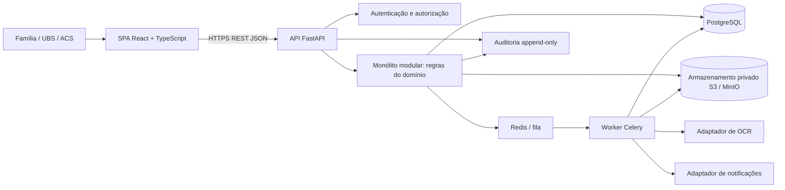
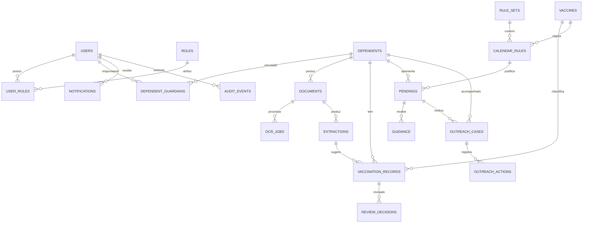

# Arquitetura esperada do ImuniGuia

## 1. Finalidade e escopo

Este documento descreve a arquitetura final esperada do ImuniGuia a partir do backlog do repositório. Cobre cadastro e acesso, dependentes, envio de cadernetas, OCR, conferência da UBS, histórico vacinal, cálculo de possíveis pendências, orientação, busca ativa, notificações, auditoria, privacidade, testes e implantação.

A implementação já existente é uma primeira entrega acadêmica do módulo de documentos. Ela prova o fluxo de cadastro simples, upload, consulta e decisão; sua interface é temporária e não é o produto final. O contrato e o comportamento útil das APIs existentes deverão ser preservados durante a evolução, com migração compatível quando necessário.

## 2. Decisão arquitetural

O sistema deve começar como um **monólito modular**, com uma API e um banco relacional. O processamento demorado de OCR e notificações pode executar em um worker separado, usando fila. Não há necessidade de dividir o produto em vários microsserviços: os módulos compartilham dependentes, registros, pendências, autorização e auditoria.

| Parte | Tecnologia esperada | Uso |
| --- | --- | --- |
| Interface | React, TypeScript e Vite | Aplicação web responsiva em uma SPA, com fluxos conforme o perfil. A implementação HTML/CSS/JavaScript atual é temporária. |
| API e regras | Python, FastAPI, Pydantic e SQLAlchemy | API REST, validação de contratos, autorização e regras de negócio. FastAPI publica OpenAPI para documentar as rotas. |
| Migrações | Alembic | Evoluir o esquema do banco com migrações reproduzíveis. |
| Banco relacional | PostgreSQL | Persistir usuários, dependentes, registros, evidências, pendências e eventos. SQLite continua útil apenas para a versão local atual. |
| Arquivos | S3 compatível, MinIO no desenvolvimento | Guardar imagens e PDFs em armazenamento privado; o banco conserva metadados e a chave do objeto. |
| Processamento assíncrono | Redis e Celery, quando OCR/notificações forem adicionados | Executar OCR e envio de notificações fora da requisição do usuário, com tentativas e estado de processamento. |
| Execução | Docker Compose para ambiente local integrado | Iniciar interface, API, worker e dependências sem instalar cada serviço manualmente. |
| Integração contínua | GitHub Actions | Executar lint, testes e build a cada alteração; publicar imagens somente quando o fluxo de deploy estiver definido. |

Essa é a stack alvo do produto, não uma descrição do código que já está implementado. Docker não é necessário para executar o protótipo atual; passa a ser útil quando PostgreSQL, MinIO, Redis, API e worker precisarem funcionar juntos em uma máquina de desenvolvimento ou demonstração.

## 3. Visão geral das camadas

### Responsabilidade por camada

1. **Interface web:** apresenta formulários e consultas por perfil, valida campos para facilitar o uso e chama a API. A interface não concede permissões nem determina sozinha estados confiáveis.
2. **API:** mantém os caminhos HTTP, valida entradas, identifica o usuário autenticado, aplica autorização por objeto e perfil, chama os serviços do domínio e transforma os resultados em respostas documentadas.
3. **Aplicação/domínio:** concentra regras de cadastro, upload, revisão, extração candidata, calendário, pendências, orientação e busca ativa. Deve ser independente dos componentes visuais.
4. **Persistência:** repositórios acessam PostgreSQL por transações e migrações. Restrições de integridade também são aplicadas no banco.
5. **Arquivos:** um adaptador de armazenamento privado recebe e entrega objetos. A API não expõe diretórios nem caminhos físicos.
6. **Worker:** executa OCR e notificações demoradas por tarefas idempotentes. Falhas ficam registradas e podem ser reprocessadas sem duplicar registros.

## 4. Módulos funcionais

### 4.1 Usuários, autenticação e perfis

- Cadastro e login com e-mail único, senha armazenada somente como hash forte e encerramento de sessão.
- Perfis do MVP: **Família/Cidadão**, **Enfermeiro/Técnico de Enfermagem** e **Agente Comunitário de Saúde (ACS)**.
- A autorização é aplicada no backend em toda rota protegida. A família acessa somente os próprios dependentes; enfermagem acessa fila e decisões autorizadas; ACS acessa somente dados necessários à busca ativa.
- A interface pode ocultar ações não disponíveis, mas isso é apenas conveniência. A API é a autoridade final.

### 4.2 Família e dependentes

- Cadastro dos dados mínimos necessários do usuário e do dependente, incluindo data de nascimento quando necessária às regras vacinais.
- Vínculo explícito entre usuário responsável e dependente, com controle de acesso validado em cada consulta.
- Consulta de dependentes, documentos enviados, histórico, situação da conferência, pendências e orientações liberadas.

### 4.3 Evidências, upload e conferência

- Upload de imagem da caderneta; formatos permitidos definidos pelo produto, tamanho limitado e validação do conteúdo no servidor.
- Pré-visualização antes do envio, associação ao dependente e confirmação de recebimento.
- Arquivo original armazenado em local privado; metadados, checksum, tamanho, tipo e chave de armazenamento persistidos no banco.
- OCR gera extrações e registros candidatos, sempre marcados **a conferir**. OCR nunca confirma dose nem altera o histórico oficial.
- A fila da UBS mostra evidência, dados candidatos, confiança/incerteza, dependente, situação e possível pendência.
- Decisão de validar ou recusar registra autor autenticado, horário, justificativa e estado anterior/novo. Recusa pode exigir orientação.

### 4.4 Registros vacinais e motor do calendário

- Distinguir um **registro candidato** (OCR ou outra evidência) de um **registro vacinal confirmado**.
- Manter catálogo de vacinas e regras versionadas por faixa etária, doses, intervalos e vigência. Cada cálculo aponta a versão/regra que produziu o resultado.
- Comparar idade e histórico confirmado para calcular **possíveis** pendências. Situações dependentes de conferência não devem ser tratadas como dose confirmada ou orientação clínica automática.
- Recalcular pendências quando um registro for validado/recusado ou quando a regra vigente for alterada, mantendo rastreabilidade.

### 4.5 UBS, orientação e busca ativa

- Enfermagem consulta e filtra a fila de validação, abre a evidência e registra decisão.
- Condutas/orientações são vinculadas ao dependente e à pendência, com autor, data e histórico; só são exibidas à família quando liberadas.
- A fila de busca ativa reúne casos segundo motivo rastreável, permite ordenar/filtrar por prioridade e deixa de exibir casos resolvidos.
- O ACS registra tipo e data do contato, nota curta e situação do acompanhamento. O histórico não é apagado quando o estado muda.
- A visualização do ACS aplica o princípio de mínimo de dados e não expõe documentos clínicos sem necessidade.

### 4.6 Notificações

- Eventos elegíveis incluem nova pendência, alteração de situação ou orientação disponibilizada.
- Notificações são idempotentes, vinculadas ao destinatário e podem ser marcadas como lidas.
- Um adaptador permite começar com notificações internas e adicionar outro canal aprovado sem acoplar o domínio a um fornecedor.

### 4.7 Auditoria e privacidade

- Registrar ações importantes: cadastro e vínculo, upload, acesso/decisão de revisão, alteração de pendência, orientação, ação de busca ativa, consentimento e acesso administrativo relevante.
- Eventos identificam ator autenticado, ação, alvo, data/hora UTC e contexto mínimo. O histórico é append-only para operações normais.
- Coletar somente dados necessários; documentar finalidade, consentimento quando aplicável, retenção, acesso e descarte conforme o escopo do projeto.
- Auditoria não deve duplicar documentos ou armazenar segredos, senhas, tokens ou conteúdo integral desnecessário.

## 5. API esperada

As rotas atuais devem continuar funcionando como base de compatibilidade. A documentação OpenAPI da API alvo deve descrever autenticação, campos, estados, erros e permissões. Novas rotas podem ser organizadas sob `/api/v1`; para as rotas já existentes, manter alias compatível ou fazer migração planejada, sem quebrar o cliente atual silenciosamente.

| Área | Rotas esperadas | Acesso principal |
| --- | --- | --- |
| Saúde | `GET /api/health` | Público, sem dados pessoais. |
| Sessão/usuários | `POST /api/v1/auth/register`, `POST /api/v1/auth/login`, `POST /api/v1/auth/logout`, `GET /api/v1/me` | Cadastro/login públicos com limites; sessão e perfil autenticados. |
| Dependentes | `GET/POST /api/dependents`, `GET/PATCH/DELETE /api/dependents/{id}` | Família responsável; equipe conforme atribuição e finalidade. |
| Documentos | `GET/POST /api/documents`, `GET /api/documents/{id}`, `GET /api/documents/{id}/file` | Upload/consulta autorizados; download protegido. |
| Decisões | `POST /api/documents/{id}/decision`, `GET /api/audit?documentId={id}` | Decisão apenas para enfermagem autorizada; auditoria conforme perfil administrativo. |
| OCR e extrações | `GET /api/v1/documents/{id}/processing`, `GET /api/v1/documents/{id}/extractions` | Família consulta estado próprio; UBS consulta a fila autorizada. |
| Registros vacinais | `GET/POST /api/v1/dependents/{id}/vaccinations`, `GET/PATCH /api/v1/vaccinations/{id}` | Família consulta; candidato só é confirmado por regra/decisão autorizada. |
| Fila UBS | `GET /api/v1/ubs/reviews?status=pendente`, `POST /api/v1/reviews/{id}/decision` | Enfermagem/Técnico de Enfermagem. |
| Regras e pendências | `GET /api/v1/dependents/{id}/pendings`, `GET /api/v1/vaccine-rules`, `POST /api/v1/pendings/{id}/recalculate` | Família consulta os próprios casos; recalcular/administrar regras exige permissão. |
| Orientações | `GET /api/v1/dependents/{id}/guidance`, `POST /api/v1/pendings/{id}/guidance` | UBS registra; responsável consulta orientação liberada. |
| Busca ativa | `GET /api/v1/acs/cases`, `GET /api/v1/acs/cases/{id}`, `POST /api/v1/acs/cases/{id}/actions` | ACS autorizado, com dados mínimos. |
| Notificações | `GET /api/v1/notifications`, `PATCH /api/v1/notifications/{id}` | Usuário autenticado consulta e marca as próprias notificações. |
| Auditoria | `GET /api/v1/audit-events?targetType=&targetId=` | Acesso restrito e auditado. |

Os endpoints adicionais acima descrevem o destino arquitetural; não afirmam que já estejam implementados. Os endpoints existentes no README são os contratos da entrega atual: saúde, dependentes, documentos, arquivo, decisão e auditoria.

## 6. Modelo de dados esperado

O diagrama abaixo é conceitual. Chaves, tipos, índices e regras de retenção devem ser detalhados nas migrações do PostgreSQL.

### Entidades principais

- **`users`, `roles`, `user_roles`**: conta, credencial protegida e perfis autorizados.
- **`dependents`, `dependent_guardians`, `consents`**: dependente, seus responsáveis e registros de consentimento/finalidade aplicáveis.
- **`documents`**: metadados do arquivo, chave privada de armazenamento, checksum, status de envio/processamento/revisão e dependente.
- **`ocr_jobs`, `extractions`**: execução, resultado, campos extraídos, confiança, erros e revisão humana.
- **`vaccines`, `rule_sets`, `calendar_rules`**: catálogo e regras versionadas com período de vigência.
- **`vaccination_records`**: vacina, dose, data, origem e estado (`a_conferir`, `validado`, `recusado` ou outro estado definido pelo domínio); OCR não cria confirmação oficial.
- **`review_decisions`**: decisão, justificativa, autor autenticado e horário.
- **`pendings`**: possível pendência, dependente, regra/versão que a originou, estado e datas.
- **`guidance`**: orientação/conduta da UBS, vínculo com pendência, autor, data e visibilidade.
- **`outreach_cases`, `outreach_actions`**: caso prioritário e histórico de ações do ACS.
- **`notifications`**: destinatário, evento, conteúdo mínimo, leitura e idempotência.
- **`audit_events`**: trilha append-only de ações e alvos relevantes.

Relações existentes que precisam migrar com integridade: um dependente possui vários documentos; cada documento pertence a um dependente; eventos de auditoria se vinculam a um documento. O esquema SQLite atual contém `dependents`, `documents` e `audit_events`; seus dados e relações devem ser migráveis ao modelo final.

## 7. Fluxos ponta a ponta

### Envio, OCR e validação

1. Família autenticada escolhe um dependente que possui vínculo com a conta, pré-visualiza e envia o arquivo.
2. API valida permissão, tamanho, formato real, metadados e limites; grava o arquivo no armazenamento privado e os metadados no banco em uma operação coerente.
3. API cria tarefa de OCR e responde que o documento foi recebido, sem esperar o processamento.
4. Worker lê o arquivo privado, gera extrações com confiança/erros e cria registros candidatos em `a_conferir`.
5. Enfermagem abre a fila, compara a evidência com os candidatos e valida ou recusa, informando justificativa quando necessário.
6. Serviço registra decisão e auditoria, recalcula pendências e cria notificações apropriadas.
7. Família acompanha o estado e consulta a orientação liberada. Somente a validação autorizada pode promover candidato a registro confirmado.

### Pendência e busca ativa

1. Motor executa regras versionadas sobre dependentes e registros confirmados, registrando a origem de cada possível pendência.
2. Família consulta pendência e orientação liberada; o sistema deixa clara a diferença entre cálculo automático, validação pendente e decisão profissional.
3. Casos que atendem aos critérios entram na fila do ACS com motivo rastreável e mínimo de dados.
4. ACS registra ações de contato; quando a pendência é resolvida, o caso sai da fila ativa, sem apagar seu histórico.

## 8. Segurança e privacidade esperadas

- HTTPS em ambientes compartilhados e de demonstração.
- Senhas com hash forte, sessão protegida em cookie `HttpOnly`, `Secure` e `SameSite` (ou mecanismo equivalente documentado); proteção CSRF quando aplicável.
- Autorização no backend em cada recurso, verificando perfil e vínculo com o dependente/objeto solicitado.
- Limites de upload, verificação de assinatura e tipo, nomes aleatórios, armazenamento privado e URLs de acesso temporárias quando houver acesso direto ao objeto.
- Segredos fora do Git e da interface, via variáveis de ambiente/gerenciador de segredos.
- Limitação de taxa nos fluxos sensíveis, validação de entrada, cabeçalhos de segurança e logs sem conteúdo de documentos ou credenciais.
- Backups e política de retenção/descarte documentada; criptografia em trânsito e em repouso conforme o ambiente.
- Coleta mínima, consentimento quando aplicável, exposição mínima por perfil e trilha de auditoria protegida contra edição normal.
- Nenhum resultado de OCR ou regra automática confirma uma dose nem substitui avaliação profissional.

## 9. Ambientes e implantação

### Desenvolvimento

`docker compose up --build` deve subir, quando a arquitetura alvo estiver implementada, os serviços `web`, `api`, `worker`, `postgres`, `redis` e `minio`. Volumes locais guardam dados de desenvolvimento e não são enviados ao Git. Um arquivo `.env.example` documenta nomes de configuração sem conter segredos.

### Demonstração/produção

- Frontend servido por proxy HTTPS; API e worker não ficam expostos diretamente à internet.
- PostgreSQL com migrações aplicadas e política de backup.
- Bucket de objetos privado, credenciais de serviço restritas e política de retenção.
- Redis e worker em rede privada; tarefas com repetição limitada, idempotência e fila de falhas.
- Variáveis e segredos configurados no ambiente de hospedagem, nunca no código.
- Deploy documentado e validação dos principais fluxos após publicação.

Docker Compose é ferramenta de desenvolvimento/demonstração reproduzível; não define sozinho a estratégia de hospedagem. A plataforma de produção deve ser escolhida na issue de deploy (#26), conforme recursos e requisitos do grupo.

## 10. Testes e qualidade

- **Unitários:** validações, transições de estado, autorização, regras do calendário e cálculo de pendências.
- **Integração:** API com PostgreSQL de teste, upload privado, auditoria, worker e migrações.
- **Ponta a ponta:** cadastro/login, dependente, upload, OCR candidato, revisão UBS, pendência, orientação, busca ativa e notificação.
- **Segurança:** tentativas de acesso entre responsáveis, perfis sem permissão, arquivo inválido/excessivo, abuso de endpoint e exposição de dados.
- **CI:** instalar versões fixadas, aplicar migrações, executar lint/testes e build; guardar artefatos de falha sem dados pessoais.

## 11. O que será reaproveitado da implementação atual

| Implementação atual | Reaproveitamento esperado |
| --- | --- |
| Rotas `GET /api/health`, `/api/dependents`, `/api/documents`, `/api/documents/{id}`, `/api/documents/{id}/file`, `/api/audit` e `POST` de dependente/documento/decisão | Manter como contratos compatíveis. A interface nova consome essas operações; novas áreas ganham endpoints próprios. |
| Campos `dependentId`, `vaccine`, `doseDate`, `note`, `file`, `decision`, `reviewer` e `note` | Preservar nomes ou oferecer adaptação compatível; documentar alterações no OpenAPI. O identificador do revisor manual será substituído por identidade autenticada. |
| Estados de documento `pendente`, `aprovado`, `rejeitado` | Manter para a revisão de evidência. Estados de OCR e do registro vacinal serão campos/entidades separados para não confundir arquivo recebido com dose confirmada. |
| Regras atuais de validação, limite, assinatura, nome interno, SHA-256 e gravação privada | Reaproveitar como base e reforçar; revisar formatos permitidos, segurança e política de retenção antes do uso real. |
| Fluxo de decisão com autor informado, data, justificativa e auditoria | Reaproveitar a transição e a trilha; trocar autor autodeclarado por usuário autenticado e atribuir autorização por perfil. |
| Tabelas `dependents`, `documents`, `audit_events` e os dados SQLite | Migrar com chaves, relacionamentos e arquivos para PostgreSQL e storage privado; não descartar registros existentes. |
| Regras que impedem que a decisão altere diretamente o histórico oficial | Preservar como regra de domínio; OCR sempre propõe candidatos para revisão humana. |
| `index.html`, `styles.css` e `app.js` | Usar somente como referência de campos e fluxo da entrega; substituir pela SPA definitiva. |
| `server.py` monolítico | Preservar lógica e contratos, reorganizando handlers, serviços e repositórios em módulos testáveis. Não é obrigatório manter `http.server` como servidor final. |

**Critério de reaproveitamento:** a evolução não começa do zero. O comportamento de upload/revisão/auditoria e o contrato das APIs são a primeira fatia funcional do produto. A reorganização interna pode trocar servidor, frontend, banco e storage, desde que migre os dados e mantenha compatibilidade dos fluxos já entregues.

## 12. Fases de evolução

1. **Base técnica e dados:** documentar estrutura, configurar FastAPI, PostgreSQL, migrações e Compose; importar dependentes/documentos/eventos atuais.
2. **Identidade e privacidade:** cadastro, login, sessões, perfis, autorização por objeto, consentimento e auditoria confiável.
3. **Contrato e interface definitiva:** documentar OpenAPI, manter aliases compatíveis e construir SPA que consome as APIs.
4. **OCR e validação:** worker e fila, extrações com confiança, candidato `a_conferir`, revisão e decisão da UBS.
5. **Calendário e pendências:** catálogo/regras versionadas, cálculo rastreável, histórico e consulta da família.
6. **Orientação, ACS e notificações:** condutas, filas prioritárias, ações de busca ativa e notificações idempotentes.
7. **Qualidade e deploy:** testes, revisão de segurança, backups, demonstração publicada e procedimento de deploy.

As issues #1–#26 descrevem esses módulos. As issues repetidas de #27–#41 devem ser tratadas como possíveis duplicatas do backlog original; antes de encerrar ou consolidar qualquer uma, conferir os vínculos do projeto e preservar o histórico. A issue #42 acompanha a evolução da interface e da segurança do módulo de documentos.
