# Modelagem de Dados do ImuniGuia

Este documento descreve o modelo Entidade-Relacionamento (DER), o dicionário de tabelas, as restrições de integridade e as decisões de modelagem implementadas em [`backend/db.py`](../backend/db.py) e nas migrações Alembic (`001` a `012`).

---

## 1. Diagrama Entidade-Relacionamento (DER)

```mermaid
erDiagram
    users ||--o{ sessions : "autentica"
    users ||--o| consent_controls : "controla revogacao"
    users ||--o{ privacy_acceptances : "registra aceites"
    users ||--o{ privacy_requests : "solicita direitos"
    users ||--o{ dependents : "acompanha (familia)"
    users ||--o{ notifications : "recebe avisos"
    users ||--o{ push_subscriptions : "inscreve navegador"
    users ||--o| reviewer_profiles : "possui perfil (ubs)"
    users ||--o{ review_assignments : "sorteado como revisor"
    users ||--o{ review_incidents : "relata impedimento"
    users ||--o{ vaccinations : "finaliza conferencia"
    users ||--o{ guidance : "escreve orientacao"
    users ||--o{ dose_plans : "planeja data"
    users ||--o{ outreach_actions : "registra contato (acs)"
    users ||--o{ audit_events : "executa acao"

    reviewer_profiles ||--o{ reviewer_changes : "historico cadastral"

    dependents ||--o{ documents : "possui cadernetas"
    dependents ||--o{ vaccinations : "historico vacinal"
    dependents ||--o{ pendings : "possiveis pendencias"
    dependents ||--o{ dose_plans : "datas individuais"
    dependents ||--o| outreach_cases : "caso de busca ativa"

    documents ||--o| ocr_jobs : "fila de leitura"
    documents ||--o{ vaccinations : "origina candidatos"
    documents ||--o{ review_assignments : "rodadas de revisao"
    documents ||--o{ review_incidents : "ocorrencias pos-voto"

    review_assignments ||--o{ review_votes : "emite votos"
    review_assignments ||--o| review_incidents : "vincula ocorrencia"
    review_incidents ||--o| review_resolutions : "resolucao administrativa"

    rule_sets ||--o{ pendings : "avalia regras"
    pendings ||--o{ guidance : "recebe orientacoes"
    pendings ||--o{ outreach_actions : "motiva contato"
    outreach_cases ||--o{ outreach_actions : "historico de contatos"
    vaccinations ||--o{ dose_plans : "conclui lembrete"

    users {
        string id PK
        text name
        string email UK
        text password_hash
        string role "familia | ubs | acs"
        text created_at
        text privacy_version
    }

    consent_controls {
        string id PK
        text user_id FK, UK
        boolean withdrawn
        text updated_at
    }

    privacy_acceptances {
        string id PK
        text user_id FK
        text version
        text policy_hash
        boolean terms_accepted
        boolean health_consent
        boolean adult_declaration
        text accepted_at
    }

    privacy_requests {
        string id PK
        text user_id FK
        text kind
        text message
        text status
        text response
        text created_at
        text answered_at
    }

    dependents {
        string id PK
        text owner_id FK "nullable na importacao legada"
        text name
        string birth_date
        text created_at
    }

    documents {
        string id PK
        text dependent_id FK
        text original_name
        text stored_name UK
        text content_type
        int size
        text sha256
        text vaccine
        string dose_date
        text family_note
        text status "pendente | aprovado | rejeitado"
        text review_note
        text review_guidance
        text created_at
        text reviewed_at
        text reviewer
        int review_round
        boolean review_hold
    }

    ocr_jobs {
        string id PK
        text document_id FK, UK
        text status "queued | processing | completed | unreadable | failed"
        int attempts
        text updated_at
        text error
        text raw_text
    }

    vaccinations {
        string id PK
        text dependent_id FK
        text document_id FK
        text vaccine
        int dose
        string dose_date
        text status "a_conferir | validado | recusado"
        text origin "ocr | transcricao_ubs"
        int confidence
        text source_key UK
        text reviewer_id FK
        text review_note
        text review_guidance
        text created_at
        text reviewed_at
    }

    rule_sets {
        string id PK
        text version UK
        text source
        text valid_from
        text valid_until
        json rules
        boolean active
        text created_at
    }

    pendings {
        string id PK
        text dependent_id FK
        text rule_set_id FK
        text rule_id
        text vaccine
        int dose
        text reason
        text status "aberta | resolvida"
        text updated_at
    }

    guidance {
        string id PK
        text pending_id FK
        text author_id FK
        text text
        boolean released
        text created_at
    }

    dose_plans {
        string id PK
        text dependent_id FK
        text vaccine
        int dose
        text due_date
        text author_id FK
        text note
        text status "ativa | concluida | cancelada"
        text created_at
        text updated_at
        text record_id FK
    }

    outreach_cases {
        string id PK
        text dependent_id FK, UK
        text status "aberta | resolvida"
        text created_at
        text updated_at
    }

    outreach_actions {
        string id PK
        text pending_id FK
        text case_id FK
        text author_id FK
        text kind
        text note
        text contact_date
        text created_at
    }

    reviewer_profiles {
        string id PK
        text user_id FK, UK
        text professional_id UK
        string birth_city_code
        string work_city_code
        text verified_at
        text verification_ref
        boolean active
    }

    reviewer_changes {
        string id PK
        text profile_id FK
        json before
        json after
        text reason
        text verification_ref
        text created_at
    }

    review_gate {
        string id PK
        int revision
    }

    review_assignments {
        string id PK
        text document_id FK
        text reviewer_id FK
        text created_at
        text status "ativa | impedido | retirada | substituida"
        json profile_snapshot
        int review_round
    }

    review_votes {
        string id PK
        text assignment_id FK
        text target_type "document | vaccination"
        text target_id
        text decision "aprovar | recusar"
        text note
        text guidance
        boolean independence_confirmed
        text evidence_hash
        text created_at
    }

    review_incidents {
        string id PK
        text document_id FK
        text assignment_id FK, UK
        text reporter_id FK
        int source_round
        text reason
        text origin
        text administrative_ref
        text created_at
    }

    review_resolutions {
        string id PK
        text incident_id FK, UK
        text administrative_ref
        text note
        text created_at
    }

    audit_events {
        string id PK
        text actor_id FK
        text target_type
        text target_id
        text event
        text details
        text created_at
    }
```

---

## 2. Decisões de Modelagem e Integridade

### 2.1 Separação estrita entre evidência documental e registro vacinal
- **`documents`** representa o arquivo enviado pela família (`pendente`, `aprovado`, `rejeitado`) e armazena o hash `sha256` dos bytes originais e o nome privado em disco (`stored_name`, nunca exposto na API).
- **`vaccinations`** representa cada dose extraída por OCR (`origin = 'ocr'`) ou digitada pela UBS (`origin = 'transcricao_ubs'`). Todo registro nasce obrigatoriamente como `a_conferir` e só passa para `validado` ou `recusado` após decisão do painel de revisão, exigindo que o documento associado já esteja `aprovado`.
- **`source_key`** (`UNIQUE` em `vaccinations`) é um hash determinístico (`documento + vacina + dose + data`) que garante idempotência do worker OCR sem duplicar candidatos em reprocessamentos.

### 2.2 Revisão independente por três profissionais e controle de rodadas
- **`reviewer_profiles`** vincula contas `ubs` a um registro profissional único (`professional_id`) e aos códigos IBGE de 7 dígitos de município de nascimento (`birth_city_code`) e de trabalho (`work_city_code`).
- **`review_assignments`** registra os 3 profissionais sorteados por documento e rodada (`review_round`), com restrição de unicidade `(document_id, reviewer_id, review_round)`. Guarda `profile_snapshot` com município, UF, RM/RIDE/AU e versão do catálogo IBGE no momento do sorteio.
- **`review_votes`** registra cada voto individual (`target_type` = `document` ou `vaccination`), com `evidence_hash` garantindo que o voto reflete exatamente o estado do arquivo/dose avaliado.
- **`review_gate`** contém a linha única `id = 'roster'` usada para serializar sorteios, votos e alterações administrativas de equipe tanto em PostgreSQL quanto em SQLite.
- **`review_incidents`**, **`review_resolutions`** e **`documents.review_hold`** tratam impedimentos identificados após um profissional já ter votado: suspendem a conferência do caso (`review_hold = true`) sem apagar votos anteriores até que a administração registre a resolução e abra nova rodada independente.

### 2.3 Motor de regras versionado, pendências e busca ativa ACS
- **`rule_sets`** armazena conjuntos de regras vacinais versionados (`version` única, `source` oficial HTTPS, vigência `valid_from`..`valid_until` e JSON de regras). Download do catálogo terminológico da RNDS nunca cria ou ativa `rule_sets`.
- **`pendings`** materializa as possíveis pendências por dependente e regra (`UNIQUE(dependent_id, rule_set_id, rule_id)`). Quando uma dose é validada e satisfaz a regra, a pendência passa a `status = 'resolvida'`, preservando o registro histórico e as orientações (`guidance`) associadas.
- **`outreach_cases`** (1:1 por `dependent_id`) desacopla a fila do Agente Comunitário de Saúde (ACS) das pendências clínicas individuais, permitindo que o histórico de contatos (`outreach_actions`) seja preservado mesmo quando pendências são resolvidas ou recalculadas.

### 2.4 Privacidade, consentimento e trilhas append-only
- **`privacy_acceptances`** registra separadamente o aceite dos termos (`terms_accepted`), o consentimento específico para dados de saúde (`health_consent`) e a declaração de maioridade/representação (`adult_declaration`), vinculados à versão e ao `policy_hash` SHA-256 do documento jurídico.
- **`consent_controls`** registra a revogação imediata (`withdrawn = true`), que bloqueia novas leituras OCR, acessos da equipe e notificações externas sem destruir dados sujeitos a avaliação de retenção.
- **Imutabilidade no banco (Triggers):** As tabelas de trilha histórica e comprovação — `audit_events` (migração 002), `review_votes` (migração 008), `privacy_acceptances` (migração 009), `reviewer_changes` (migração 011), `review_incidents` e `review_resolutions` (migração 012) — possuem triggers de banco (`BEFORE UPDATE OR DELETE`) em PostgreSQL e SQLite que impedem qualquer edição ou exclusão de registros lançados.

---

## 3. Histórico de Migrações (Alembic)

| Revisão | Arquivo | Objetivo |
| --- | --- | --- |
| `001` | `001_initial.py` | Esquema base (`users`, `sessions`, `auth_attempts`, `dependents`, `documents`, `audit_events`, `ocr_jobs`, `vaccinations`, `rule_sets`, `pendings`, `guidance`, `notifications`, `outreach_actions`, `privacy_requests`). |
| `002` | `002_audit_immutable.py` | Triggers de imutabilidade (`append-only`) para `audit_events`. |
| `003` | `003_push_subscriptions.py` | Tabela `push_subscriptions` para Web Push privado opt-in. |
| `004` | `004_dose_plans.py` | Tabela `dose_plans` para datas individualizadas planejadas pela UBS. |
| `005` | `005_outreach_cases.py` | Tabela `outreach_cases` por pessoa e migração de contatos ACS anteriores. |
| `006` | `006_assignments_feedback.py` | Campos `review_guidance` em documentos/vacinações e estrutura inicial de atribuição. |
| `007` | `007_independent_review.py` | Tabelas `reviewer_profiles`, `review_assignments` e `review_votes`; reabertura auditada de decisões simples legadas. |
| `008` | `008_immutable_votes.py` | Triggers de imutabilidade (`append-only`) para `review_votes`. |
| `009` | `009_privacy_acceptance.py` | Tabela `privacy_acceptances` com triggers de imutabilidade. |
| `010` | `010_consent_controls.py` | Tabela `consent_controls` para revogação e pausa de processamento. |
| `011` | `011_review_rounds.py` | Rodadas de revisão (`review_round`), `review_gate` (semente `roster=1`) e histórico imutável `reviewer_changes`. |
| `012` | `012_late_impediments.py` | Coluna `documents.review_hold` e tabelas imutáveis `review_incidents` e `review_resolutions`. |
